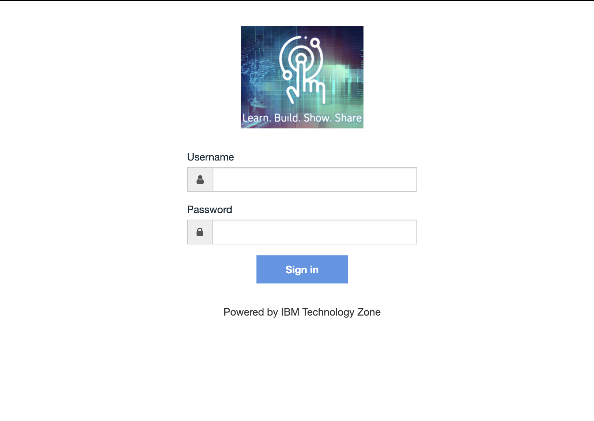
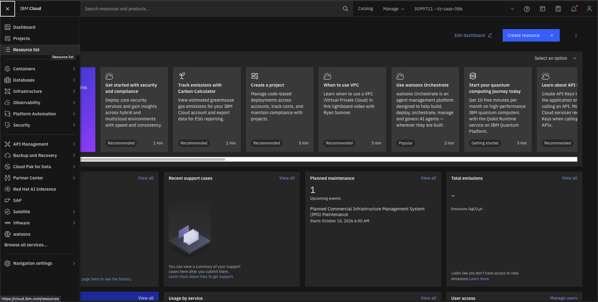
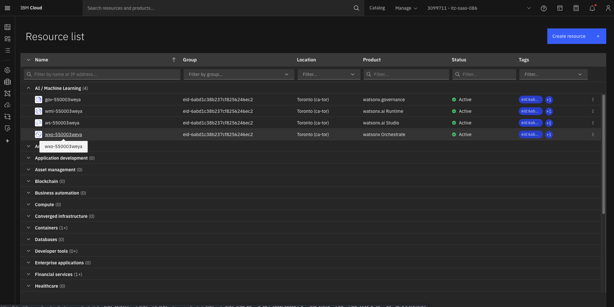
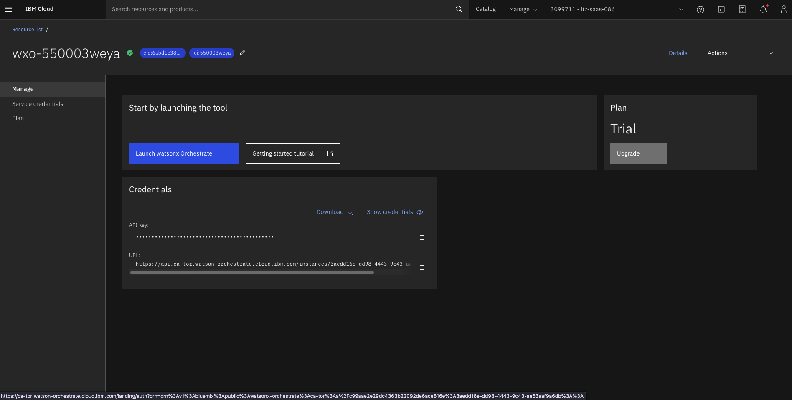
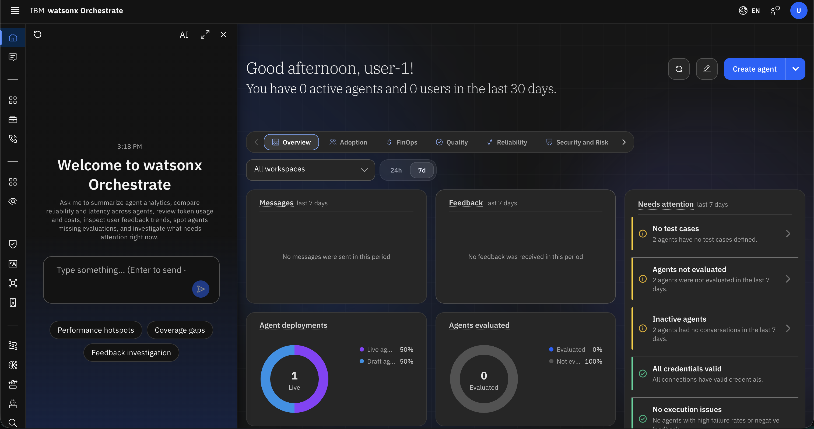
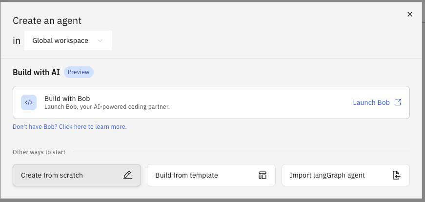

# Setting Up a Salesforce Agent in watsonx Orchestrate

This guide walks you through connecting a Salesforce org to watsonx Orchestrate (WXO) and building an AI agent that can query, create, and update Salesforce records through natural language. Salesforce does not have a prebuilt WXO app — the integration is done by creating a Salesforce Connected App for OAuth, obtaining a session token, and importing custom OpenAPI tool definitions that point at the Salesforce REST API.

---

## What You Will Build

A **native AI agent** in watsonx Orchestrate that:
- Authenticates to a Salesforce org using OAuth 2.0 (Username-Password flow via a Connected App)
- Can search records with SOQL, create and update standard objects (Lead, Opportunity, Case, Account, Contact), and retrieve record details
- Exposes those capabilities as WXO tools an agent can call on demand
- Is ready to be used standalone or wired as a collaborator into a supervisor agent

---

## How the Integration Works

```
WXO Agent
   │
   ├── custom tool: soql_query           ──► GET  /services/data/v60.0/query?q=...
   ├── custom tool: create_record        ──► POST /services/data/v60.0/sobjects/{object}/
   ├── custom tool: update_record        ──► PATCH /services/data/v60.0/sobjects/{object}/{id}
   └── custom tool: get_record           ──► GET  /services/data/v60.0/sobjects/{object}/{id}
             │
             ▼
     Salesforce REST API
     (Authorization: Bearer <session_token>)
```

Salesforce issues a session token when you authenticate via a Connected App. That token is stored as the bearer credential on each WXO custom tool.

---

## Prerequisites

| Requirement | Details |
|---|---|
| WXO tenant URL | Provided by your administrator (e.g. `https://<instance>.watson-orchestrate.ibm.com`) |
| WXO login credentials | IBMid or tenant-specific credentials with **Agent Builder** or **Admin** role |
| Salesforce org URL | Your org's My Domain URL (e.g. `https://<your-org>.my.salesforce.com`) — find it under **Setup → My Domain** |
| Salesforce username | The integration user's login email |
| Salesforce password + security token | The user's password with the security token appended (e.g. `MypasswordXYZ123token`) — reset the token at **Settings → My Personal Information → Reset My Security Token** |
| Salesforce Connected App | A Connected App in your org configured for OAuth 2.0 (created in Part 2 below) |
| Your initials | Used to namespace your agent name — all participants on a shared tenant must use unique names |

> **Salesforce permissions required:** The integration user needs at minimum **API Enabled** permission plus read/write access on the objects your agent will interact with (e.g. Lead, Opportunity, Case). A dedicated integration user with a Permission Set is recommended over using a named user.

---

## Part 1 — Log In to watsonx Orchestrate

### Step 1.1 — Log In to IBM Cloud

Open a browser and navigate to the IBM Cloud URL provided in your environment email. Sign in with the credentials provided.



### Step 1.2 — Open the Resource List

After logging in, click the **hamburger menu** (☰) in the top-left corner, then click **Resource list**.



### Step 1.3 — Locate the watsonx Orchestrate Instance

In the Resource list, expand **AI / Machine Learning**. Find the watsonx Orchestrate row and click it.



### Step 1.4 — Launch watsonx Orchestrate

Click **Launch watsonx Orchestrate**. You will land on the WXO home screen.



---

## Part 2 — Create a Salesforce Connected App

WXO calls the Salesforce REST API using a session token obtained via OAuth 2.0. You need a Connected App in your Salesforce org to obtain that token.

### Step 2.1 — Navigate to App Manager

In Salesforce, go to **Setup** (gear icon → Setup) → search for **App Manager** in the Quick Find box → click **App Manager**.

### Step 2.2 — Create a New Connected App

Click **New Connected App** (top-right).

Fill in the following fields:

| Field | Value |
|---|---|
| **Connected App Name** | `WXO Integration` (or any descriptive name) |
| **API Name** | Auto-populated from the name |
| **Contact Email** | Your email address |
| **Enable OAuth Settings** | ✅ Check this box |
| **Callback URL** | `https://login.salesforce.com/services/oauth2/success` (placeholder — not used for this flow) |
| **Selected OAuth Scopes** | Add: **Manage user data via APIs (api)** and **Perform requests at any time (refresh_token, offline_access)** |
| **Require Secret for Web Server Flow** | ✅ Check this box |

Click **Save**, then **Continue**. Salesforce will show your new app's **Consumer Key** (Client ID) and **Consumer Secret** (Client Secret). Copy both values — you will need them to obtain a session token.

> It takes **2–10 minutes** for a new Connected App to be active. If authentication fails immediately, wait a few minutes and retry.

### Step 2.3 — Obtain a Session Token

Run the following command in a terminal, substituting your values:

```bash
curl -X POST "https://login.salesforce.com/services/oauth2/token" \
  -d "grant_type=password" \
  -d "client_id=<CONSUMER_KEY>" \
  -d "client_secret=<CONSUMER_SECRET>" \
  -d "username=<SALESFORCE_USERNAME>" \
  -d "password=<PASSWORD_PLUS_SECURITY_TOKEN>"
```

> **Sandbox orgs:** Replace `login.salesforce.com` with `test.salesforce.com`.

A successful response looks like:

```json
{
  "access_token": "00D...",
  "instance_url": "https://<your-org>.my.salesforce.com",
  "token_type": "Bearer"
}
```

Copy the `access_token` value — this is your bearer token for WXO tool authentication.

> **Token lifetime:** Salesforce session tokens expire based on your org's **Session Settings → Session Timeout** policy (default 2 hours). For production use, implement a token refresh mechanism or use a long-lived Connected App access token policy. For lab/testing purposes, re-run the curl command when the token expires.

---

## Part 3 — Prepare the Salesforce OpenAPI Tool Definitions

Each Salesforce action becomes a WXO custom tool defined as an OpenAPI 3.0 YAML file.

> **Before you start:** Replace every occurrence of `<SF_INSTANCE_URL>` with your org's My Domain hostname only — no `https://`, no trailing slash (e.g. `myorg.my.salesforce.com`).

### Tool 1 — `soql_query`

Save the following as `sf_soql_query.yaml`:

```yaml
openapi: 3.0.0
info:
  title: Salesforce SOQL Query
  version: "1.0"
servers:
  - url: https://<SF_INSTANCE_URL>
paths:
  /services/data/v60.0/query:
    get:
      operationId: soql_query
      summary: Execute a SOQL query against Salesforce
      description: >
        Runs a Salesforce Object Query Language (SOQL) SELECT statement and
        returns matching records. Use this to search for Leads, Opportunities,
        Cases, Accounts, Contacts, or any standard/custom object.
        Example: SELECT Id, Name, StageName FROM Opportunity WHERE CloseDate = THIS_QUARTER
      parameters:
        - name: q
          in: query
          required: true
          schema:
            type: string
          description: >
            The SOQL query string. Must start with SELECT. URL-encode spaces as +
            or %20. Example: SELECT+Id,Name,Email+FROM+Lead+WHERE+Status='Open'
      responses:
        "200":
          description: Query results
          content:
            application/json:
              schema:
                type: object
                properties:
                  totalSize:
                    type: integer
                  done:
                    type: boolean
                  records:
                    type: array
                    items:
                      type: object
      security:
        - bearerAuth: []
components:
  securitySchemes:
    bearerAuth:
      type: http
      scheme: bearer
```

### Tool 2 — `create_record`

Save the following as `sf_create_record.yaml`:

```yaml
openapi: 3.0.0
info:
  title: Salesforce Create Record
  version: "1.0"
servers:
  - url: https://<SF_INSTANCE_URL>
paths:
  /services/data/v60.0/sobjects/{sobject}:
    post:
      operationId: create_record
      summary: Create a new Salesforce record
      description: >
        Creates a new record for the specified Salesforce object type (sobject).
        Common values for sobject: Lead, Opportunity, Case, Account, Contact, Task.
        The body must contain the fields required by that object.
        Returns the Id of the newly created record.
      parameters:
        - name: sobject
          in: path
          required: true
          schema:
            type: string
          description: >
            The Salesforce object API name (e.g. Lead, Opportunity, Case, Contact).
      requestBody:
        required: true
        content:
          application/json:
            schema:
              type: object
              description: >
                Key-value pairs of field API names and their values.
                Example for Lead: {"FirstName":"Jane","LastName":"Smith",
                "Company":"Acme","Email":"jane@acme.com","Status":"Open - Not Contacted"}
              additionalProperties: true
      responses:
        "201":
          description: Record created successfully
          content:
            application/json:
              schema:
                type: object
                properties:
                  id:
                    type: string
                    description: The Salesforce Id of the newly created record.
                  success:
                    type: boolean
      security:
        - bearerAuth: []
components:
  securitySchemes:
    bearerAuth:
      type: http
      scheme: bearer
```

### Tool 3 — `update_record`

Save the following as `sf_update_record.yaml`:

```yaml
openapi: 3.0.0
info:
  title: Salesforce Update Record
  version: "1.0"
servers:
  - url: https://<SF_INSTANCE_URL>
paths:
  /services/data/v60.0/sobjects/{sobject}/{id}:
    patch:
      operationId: update_record
      summary: Update fields on an existing Salesforce record
      description: >
        Updates one or more fields on an existing Salesforce record identified
        by its object type and record Id.
        A successful update returns HTTP 204 with no body.
      parameters:
        - name: sobject
          in: path
          required: true
          schema:
            type: string
          description: The Salesforce object API name (e.g. Lead, Opportunity, Case).
        - name: id
          in: path
          required: true
          schema:
            type: string
          description: The 15- or 18-character Salesforce record Id.
      requestBody:
        required: true
        content:
          application/json:
            schema:
              type: object
              description: >
                Key-value pairs of the fields to update and their new values.
                Only include fields that need to change.
              additionalProperties: true
      responses:
        "204":
          description: Record updated successfully (no body returned)
      security:
        - bearerAuth: []
components:
  securitySchemes:
    bearerAuth:
      type: http
      scheme: bearer
```

### Tool 4 — `get_record`

Save the following as `sf_get_record.yaml`:

```yaml
openapi: 3.0.0
info:
  title: Salesforce Get Record
  version: "1.0"
servers:
  - url: https://<SF_INSTANCE_URL>
paths:
  /services/data/v60.0/sobjects/{sobject}/{id}:
    get:
      operationId: get_record
      summary: Retrieve a Salesforce record by Id
      description: >
        Fetches all accessible fields for a specific Salesforce record.
        Use this after create_record or soql_query to get the full details
        of a record by its Id.
      parameters:
        - name: sobject
          in: path
          required: true
          schema:
            type: string
          description: The Salesforce object API name (e.g. Lead, Opportunity, Case).
        - name: id
          in: path
          required: true
          schema:
            type: string
          description: The 15- or 18-character Salesforce record Id.
      responses:
        "200":
          description: Record fields
          content:
            application/json:
              schema:
                type: object
                description: All accessible fields for the record as key-value pairs.
                additionalProperties: true
      security:
        - bearerAuth: []
components:
  securitySchemes:
    bearerAuth:
      type: http
      scheme: bearer
```

---

## Part 4 — Import the Tools into WXO

### Step 4.1 — Open Tools Management

From the WXO home screen, navigate to **Tools** in the left sidebar (or **Build → Tools**, depending on your WXO version).

### Step 4.2 — Create the First Custom Tool

Click **Create tool** → **From file** (or **Import OpenAPI**).

Upload `sf_soql_query.yaml`. WXO will parse the spec and show you the operation summary.

In the **Authentication** section, select **Bearer token** and paste the `access_token` you obtained in Part 2, Step 2.3:

```
Authorization: Bearer 00D...
```

Click **Save tool**.

### Step 4.3 — Repeat for Each Remaining Tool

Repeat Step 4.2 for each remaining YAML file, using the same bearer token for all four:

| File | Tool created |
|---|---|
| `sf_create_record.yaml` | `create_record` |
| `sf_update_record.yaml` | `update_record` |
| `sf_get_record.yaml` | `get_record` |

> All four tools are now available in your WXO tenant's tool library and can be added to any agent.

---

## Part 5 — Create the Salesforce Agent

### Step 5.1 — Start a New Agent

From the WXO home screen, click **Create Agent** (top-right corner).



### Step 5.2 — Create from Scratch

Click **Create from scratch**.



### Step 5.3 — Fill In Agent Name, Description, and Instructions

> ⚠️ **Multi-Tenant Sharing:** If you share a WXO tenant with others, **append your initials** to the agent name to avoid collisions.

**Agent Name:**
```
salesforce_agent_<initials>
```

**Description:**
```
Queries, creates, and updates Salesforce CRM records through natural language. Supports Leads, Opportunities, Cases, Accounts, Contacts, and Tasks via SOQL search and the Salesforce REST API.
```

**Instructions:** paste the full block below and customise the bracketed sections for your org:

```
You are a Salesforce CRM assistant. You interact with a Salesforce org on behalf
of the user by calling the available tools.

Available tools and when to use them:
- soql_query    → When the user asks to find, list, search, or report on records.
- create_record → When the user asks to create, add, or log a new record.
- update_record → When the user asks to update, change, close, or modify a record.
- get_record    → When the user needs all fields for a specific record by Id.

Rules:
- Never ask clarifying questions if you have enough information to act.
- Always include the record Id in your response after create or update operations.
- When creating a record, confirm the object type and required fields before calling
  create_record. Do not assume field values the user did not provide.
- When running SOQL, write valid SOQL syntax. Use single quotes around string values.
  Limit results to 10 rows unless the user specifies otherwise (add LIMIT 10).
- If update_record returns HTTP 204, confirm the update succeeded even though there
  is no response body.
- Do not infer or fabricate record Ids, field values, or query results.
- If a tool returns an error, include the error code and message in your response.

Common Salesforce object API names:
  Lead, Opportunity, Case, Account, Contact, Task, Event, Campaign

Common required fields by object (adapt to your org's validation rules):
  Lead:        LastName, Company
  Opportunity: Name, StageName, CloseDate, AccountId
  Case:        Subject
  Contact:     LastName

[Add any org-specific picklist values or field mappings here, for example:]
  Opportunity StageName values: Prospecting, Qualification, Proposal/Price Quote,
    Negotiation/Review, Closed Won, Closed Lost
  Lead Status values: Open - Not Contacted, Working - Contacted, Closed - Converted,
    Closed - Not Converted
```

---

## Part 6 — Add the Salesforce Tools to the Agent

### Step 6.1 — Open the Tools Tab

From within the agent editor, click the **Tools** tab.

### Step 6.2 — Add Each Custom Tool

Click **Add tool** → **Custom tools** (or **My tools**). Select all four Salesforce tools:

- `soql_query`
- `create_record`
- `update_record`
- `get_record`

Click **Add** to attach them to the agent.

### Step 6.3 — Save the Agent

Click **Save**.

---

## Part 7 — Test the Agent in Draft Preview

### Step 7.1 — Search for Records

Paste the following into the draft preview chat and press **Enter**:

```
Find all open Opportunities closing this quarter with a value over $50,000.
```

**Expected behaviour:**
- Agent constructs a SOQL query such as:
  `SELECT Id, Name, StageName, Amount, CloseDate FROM Opportunity WHERE CloseDate = THIS_QUARTER AND Amount > 50000 AND IsClosed = false LIMIT 10`
- Calls `soql_query` and returns a formatted list of matching records

### Step 7.2 — Create a Record

```
Create a new Lead: Jane Smith, Company: Acme Corp, Email: jane@acme.com,
Phone: 415-555-1234. Source: Web.
```

**Expected behaviour:**
- Agent calls `create_record` with `sobject: "Lead"` and the provided field values
- Returns the new record Id, e.g. `Lead created. Id: 00Q8Z000004XyZAU0`

### Step 7.3 — Update a Record

```
Update Lead 00Q8Z000004XyZAU0: set Status to "Working - Contacted" and
add a note in Description: "Called on 2026-01-15, left voicemail."
```

**Expected behaviour:**
- Agent calls `update_record` with `sobject: "Lead"`, the record Id, and the two field updates
- Reports success (HTTP 204 means the update was applied)

### Step 7.4 — Get a Full Record

```
Show me all the details for Lead 00Q8Z000004XyZAU0.
```

**Expected behaviour:**
- Agent calls `get_record` with `sobject: "Lead"` and the Id
- Returns all accessible fields for that record

---

## Part 8 — Wire the Salesforce Agent as a Collaborator (Optional)

If you have a supervisor agent that decides *when* to create or update a Salesforce record (for example, an alert triage agent that logs a Case whenever severity is HIGH), register the Salesforce agent as a **collaborator tool**.

### Step 8.1 — Open Your Supervisor Agent

Navigate to your existing supervisor agent and open it in the editor.

### Step 8.2 — Add the Salesforce Agent as a Collaborator

Click **Tools** tab → **Add tool** → **Agent as tool**.

Select `salesforce_agent_<initials>` and click **Add**.

### Step 8.3 — Update the Supervisor Instructions

Add a delegation rule, for example:

```
When the analysis produces a severity of HIGH or CRITICAL, delegate to
salesforce_agent_<initials> to create a Salesforce Case. Pass the subject,
description, and priority (HIGH → Priority: High, CRITICAL → Priority: High).
Include the returned Case Id in your final response.
```

---

## Troubleshooting Reference

| Symptom | Likely Cause | Fix |
|---|---|---|
| Token request returns `invalid_client_credentials` | Consumer Key or Secret entered incorrectly | Re-copy the Consumer Key and Secret from **Setup → App Manager → [your app] → View** |
| Token request returns `authentication failure` | Password or security token is wrong, or token not appended correctly | Password field must be `<password><securitytoken>` with no separator. Reset the token at **Settings → Reset My Security Token** |
| Token request returns `inactive org or user` | Org is a sandbox; used wrong login URL | Use `test.salesforce.com` instead of `login.salesforce.com` for sandbox orgs |
| Tool import fails with "invalid spec" | YAML syntax error or wrong `<SF_INSTANCE_URL>` format | The `servers.url` must be `https://<host>` with no trailing slash. Validate at [editor.swagger.io](https://editor.swagger.io) |
| Tool returns HTTP 401 | Session token expired | Re-run the curl command from Part 2 Step 2.3 and update the bearer token on all four tools |
| Tool returns HTTP 403 | Integration user lacks field or object permissions | Grant the user a Permission Set with API Enabled + the necessary object permissions in Salesforce Setup |
| `create_record` returns `REQUIRED_FIELD_MISSING` | A required field for that object wasn't included | Check the error body for the missing field name and add it to the agent instructions' required fields list |
| `update_record` appears to succeed but field didn't change | Field is read-only or managed by a workflow/validation rule | Check the field's Edit access in the integration user's profile and inspect any active Flows or Validation Rules |
| Agent sends malformed SOQL | Special characters or unescaped strings | Add explicit SOQL formatting examples to the agent instructions; always use single quotes around string literals |
| Collaborator not invoked by supervisor | Delegation rule too vague | Add explicit trigger keywords (e.g. "when Case creation is needed") to the supervisor's instructions |

---

## What You Accomplished

In this guide, you:

1. ✅ Created a Salesforce Connected App and obtained a session token via OAuth 2.0 Username-Password flow
2. ✅ Authored four Salesforce OpenAPI tool definitions: SOQL query, create record, update record, and get record
3. ✅ Imported those tools into WXO with Salesforce bearer token authentication
4. ✅ Built a native Salesforce CRM agent with domain-adaptable instructions
5. ✅ Tested record search, creation, update, and retrieval in the WXO draft preview
6. ✅ (Optional) Wired the Salesforce agent as a collaborator in a supervisor agent for automated CRM delegation

The four tools are reusable across any WXO agent on your tenant — import once, delegate from as many orchestration flows as you need.
