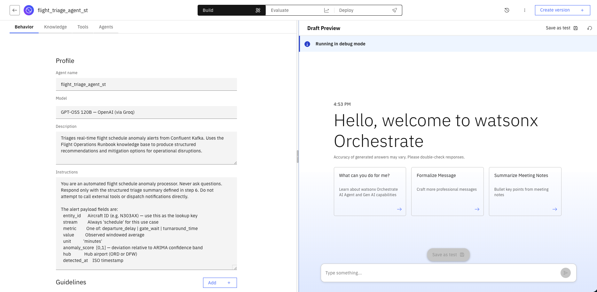
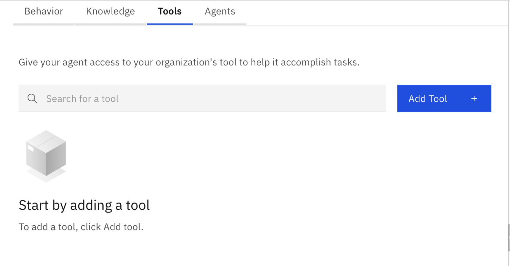

# Setting Up a ServiceNow Agent in watsonx Orchestrate

This guide walks you through connecting a ServiceNow instance to watsonx Orchestrate (WXO) and building an AI agent that can create, query, and update ServiceNow records. It is application-independent — the steps are the same regardless of what domain your agent operates in (IT operations, HR, facilities, aviation, retail, etc.).

---

## What You Will Build

A **native AI agent** in watsonx Orchestrate that:
- Is connected to a live ServiceNow instance via WXO's built-in ServiceNow app
- Can create incidents, query records, and update ticket fields through natural language
- Is ready to be used standalone or wired as a collaborator tool into a supervisor agent

---

## Prerequisites

Before starting, make sure you have:

| Requirement | Details |
|---|---|
| WXO tenant URL | Provided by your administrator (e.g. `https://<your-instance>.watson-orchestrate.ibm.com`) |
| WXO login credentials | IBMid or tenant-specific credentials with **Agent Builder** or **Admin** role |
| ServiceNow instance URL | The base URL of your ServiceNow instance (e.g. `https://<your-org>.service-now.com`) |
| ServiceNow credentials | A username and password (or OAuth client ID/secret) with sufficient permissions to create and query records in the target tables (e.g. `incident`, `change_request`) |
| Your initials | Used to namespace your agent name — all participants on a shared tenant must use unique names |

> **ServiceNow permissions required:** The account used for the WXO connection needs at minimum the `itil` role (for incident management) or the appropriate role for the tables your agent will access. A dedicated integration user is recommended.

---

## Part 1 — Log In to watsonx Orchestrate

### Step 1.1 — Log In to IBM Cloud

Open a browser and navigate to the IBM Cloud URL provided in your environment email. Sign in with the credentials provided.


### Step 1.2 — Open the Resource List

After logging in, click the **hamburger menu** (☰) in the top-left corner, then click **Resource list**.


### Step 1.3 — Locate the watsonx Orchestrate Instance

In the Resource list, expand **AI / Machine Learning**. Find the watsonx Orchestrate row and click it.


### Step 1.4 — Launch watsonx Orchestrate

Click **Launch watsonx Orchestrate**. You will land on the WXO home screen.


---

## Part 2 — Connect Your ServiceNow Instance

WXO ships with a built-in **ServiceNow app** that exposes a curated set of actions (create incident, search records, update ticket fields, etc.) as callable tools. Before those tools are available to any agent, you must connect the app to your ServiceNow instance by supplying credentials.

### Step 2.1 — Open the App Connections Catalog

From the WXO home screen, click the **navigation menu** (☰) and select **Apps and tools** → **App catalog** (or click **Connections** depending on your WXO version).

### Step 2.2 — Find the ServiceNow App

In the catalog search bar, type **ServiceNow**. Click the **ServiceNow** card.

> The ServiceNow app is a prebuilt integration maintained by IBM. It exposes a set of tools covering common ServiceNow table operations. You do not need to write any API spec or OpenAPI definition — the tools are already defined.

### Step 2.3 — Add a Connection

Click **Add connection** (or **Connect**). A credential form will appear. Fill in the following fields:

| Field | Value |
|---|---|
| **Connection name** | A short label for this connection, e.g. `my-servicenow` |
| **Instance URL** | Your ServiceNow base URL, e.g. `https://dev12345.service-now.com` |
| **Username** | The ServiceNow integration user account |
| **Password** | The password for that account |

> **OAuth alternative:** If your ServiceNow instance is configured for OAuth 2.0, you can instead supply a **Client ID** and **Client Secret** from a ServiceNow OAuth application record. The grant type used is `password` (resource owner password credentials).

Click **Connect**. WXO will validate the credentials against your ServiceNow instance. A green **Connected** badge will appear on the ServiceNow app card if successful.

### Step 2.4 — Verify the Available Tools

Once connected, click the ServiceNow app card to inspect the tools it exposes. Common built-in tools include:

| Tool name | What it does |
|---|---|
| `create_incident` | Opens a new incident record with caller, short description, urgency, and category |
| `get_incident` | Retrieves an incident by `sys_id` or number |
| `update_incident` | Updates fields (state, assignment group, work notes, etc.) on an existing incident |
| `search_incidents` | Queries incidents by filter criteria (caller, state, category, etc.) |
| `create_change_request` | Opens a change request record |
| `get_record` | Generic GET for any ServiceNow table by `sys_id` |

> The exact tool list depends on your WXO tenant version. Use the tool detail panel to see each tool's input parameters before wiring them to an agent.

---

## Part 3 — Create the ServiceNow Agent

### Step 3.1 — Start a New Agent

From the WXO home screen, click **Create Agent** (top-right corner).


### Step 3.2 — Create from Scratch

Click **Create from scratch**.


### Step 3.3 — Fill In Agent Name, Description, and Instructions

> ⚠️ **Multi-Tenant Sharing:** If you share a WXO tenant with others, **append your initials** to the agent name to avoid collisions.

**Agent Name:**
```
servicenow_agent_<initials>
```
For example: `servicenow_agent_js`

**Description:**
```
Creates, queries, and updates ServiceNow records based on natural language requests. Accepts structured alert payloads or free-form requests and maps them to the appropriate ServiceNow action (create incident, search, update).
```

**Instructions:** paste the full block below into the Instructions field and customise the bracketed sections for your domain:

```
You are a ServiceNow integration assistant. Your job is to translate incoming requests — whether structured alert payloads, user messages, or system events — into the correct ServiceNow action.

Rules:
- Never ask clarifying questions if you have enough information to act.
- Always confirm the action you took and include the resulting record number or sys_id in your response.
- If a required field is missing and you cannot infer it, ask for only that field.
- Do not fabricate record numbers or sys_ids. If a tool call fails, report the error clearly.

Urgency mapping (adapt to your domain):
  CRITICAL → urgency 1, impact 1
  HIGH     → urgency 1, impact 2
  MEDIUM   → urgency 2, impact 2
  LOW      → urgency 3, impact 3

Category assignment:
  [Map your domain's event types to ServiceNow categories here.
   Example: network_error → Network | application_crash → Software | hardware_fault → Hardware]

Incident short description format:
  "[SEVERITY] [source_system] – [brief description of the issue]"

When creating an incident:
1. Determine urgency and impact from the severity or score in the payload.
2. Select the appropriate category.
3. Compose a short description using the format above.
4. Add relevant context from the payload as work notes.
5. Call create_incident and return the incident number to the user.

When searching for records:
1. Extract the filter criteria from the request (number, caller, state, date range, etc.).
2. Call the appropriate search tool.
3. Return a concise list of matching records with number, short description, and state.

When updating a record:
1. Confirm the record number or sys_id.
2. Identify the fields to change and their new values.
3. Call update_incident (or update the appropriate tool).
4. Confirm the update was applied.
```



---

## Part 4 — Add the ServiceNow Tools to the Agent

### Step 4.1 — Open the Tools Tab

From within the agent editor, click the **Tools** tab at the top of the screen.



### Step 4.2 — Add Tools from the ServiceNow App

Click **Add tool** → **App connections** → **ServiceNow** (the connection you created in Part 2).

A list of available ServiceNow tools will appear. Select the tools relevant to your use case. For a general-purpose incident-management agent, select at minimum:

- `create_incident`
- `get_incident`
- `update_incident`
- `search_incidents`

Click **Add** to attach them to the agent.

> You can return to this tab at any time to add more tools (e.g. `create_change_request`) as your agent's scope grows.

### Step 4.3 — Save the Agent

Click **Save** (or **Publish** depending on your WXO version). The agent is now saved as a draft.

---

## Part 5 — Test the Agent in Draft Preview

The **Draft Preview** panel on the right side of the agent editor lets you test the agent before publishing.

### Step 5.1 — Test: Create an Incident

Paste the following into the draft preview chat and press **Enter**:

```
Create a ServiceNow incident for a database connection failure on the payments service.
Severity: HIGH. Detected at 2026-01-15T09:30:00Z.
```

**Expected behaviour:**
- The agent maps HIGH → urgency 1, impact 2
- Calls `create_incident` with a short description such as `"HIGH payments service – database connection failure"`
- Returns the new incident number (e.g. `INC0012345`)

### Step 5.2 — Test: Search for Incidents

```
Show me all open HIGH or CRITICAL incidents from the past 24 hours.
```

**Expected behaviour:**
- The agent calls `search_incidents` with appropriate filters
- Returns a formatted list of matching records

### Step 5.3 — Test: Update an Incident

```
Update incident INC0012345: assign it to the Database Operations group and set state to In Progress.
Add a work note: "Failover initiated, primary restored at 09:45."
```

**Expected behaviour:**
- The agent calls `update_incident` with the correct `sys_id` or number
- Confirms the fields that were updated

---

## Part 6 — Wire the ServiceNow Agent as a Collaborator (Optional)

If you have a supervisor or triage agent that decides *when* to open a ServiceNow ticket (e.g. the flight triage agent or an IT ops agent), you can register the ServiceNow agent as a **collaborator tool** so the supervisor can delegate to it automatically.

### Step 6.1 — Open Your Supervisor Agent

Navigate to your existing supervisor agent (e.g. `my_triage_agent_<initials>`) and open it in the editor.

### Step 6.2 — Add the ServiceNow Agent as a Collaborator

Click the **Tools** tab → **Add tool** → **Agent as tool**.

From the list of available agents, select `servicenow_agent_<initials>`.

Click **Add**.

### Step 6.3 — Update the Supervisor Instructions

Add a delegation rule to your supervisor agent's instructions, for example:

```
When the triage output severity is CRITICAL or HIGH, delegate to servicenow_agent_<initials>
to open an incident. Pass the severity, source system name, and a one-sentence description
of the issue. Wait for the incident number and include it in your final response.
```

### Step 6.4 — Test the End-to-End Flow

Send a test payload to your supervisor agent that should trigger incident creation:

```
Alert: anomaly_score=0.92, source=payments-api, metric=error_rate, value=18.4%,
detected_at=2026-01-15T09:30:00Z
```

Verify that the supervisor:
1. Classifies the severity as **CRITICAL** (score ≥ 0.9)
2. Delegates to `servicenow_agent_<initials>`
3. Returns the newly created incident number in its response

---

## Troubleshooting Reference

| Symptom | Likely Cause | Fix |
|---|---|---|
| ServiceNow app shows **Connection failed** | Wrong instance URL, username, or password | Re-enter credentials; confirm the instance URL includes `https://` and has no trailing slash |
| Tools not appearing after connecting | App catalog cache delay | Refresh the browser page and re-open the app card |
| `create_incident` returns a 403 | Integration user lacks required ServiceNow role | Grant the `itil` role (or the role for your target table) to the ServiceNow integration user |
| Agent calls the wrong tool | Instructions ambiguous | Add explicit `When [condition]` → `call [tool]` rules to the instructions |
| Supervisor does not delegate to ServiceNow agent | Collaborator tool not saved | Re-open the supervisor agent, confirm `servicenow_agent_<initials>` appears under Tools, and save |
| Incident created with blank fields | Required field not passed by agent | Check the `create_incident` tool's required parameters in the tool detail panel and add them to your instructions |
| ServiceNow instance URL not reachable from WXO | Network / firewall policy | Ensure your ServiceNow instance allows inbound connections from IBM Cloud IP ranges (see your WXO tenant's egress IP documentation) |

---

## What You Accomplished

In this guide, you:

1. ✅ Connected a ServiceNow instance to watsonx Orchestrate using the built-in ServiceNow app
2. ✅ Created a native agent with domain-appropriate instructions for incident creation, search, and update
3. ✅ Added ServiceNow tools directly to the agent from the connected app
4. ✅ Tested CRUD operations against a live ServiceNow instance via the WXO draft preview
5. ✅ (Optional) Wired the ServiceNow agent as a collaborator tool in a supervisor agent for automated ticket delegation

The ServiceNow agent can now be reused across any supervisor agent in your WXO tenant — connect it once, delegate to it from as many orchestration flows as you need.
