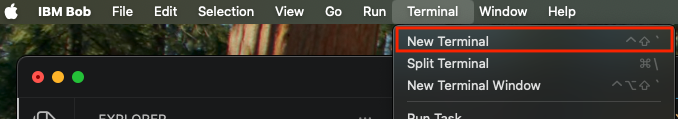
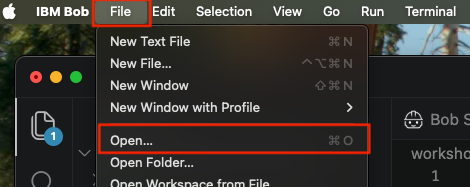
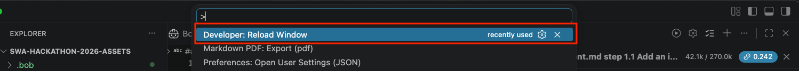
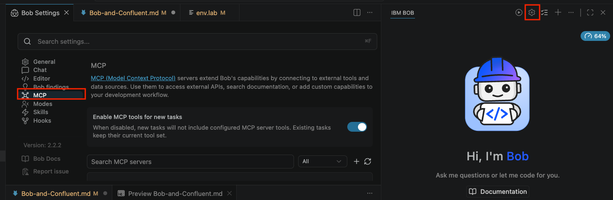

# Lab: Bob + Confluent — Real-Time Flight Anomaly Detection

**Hackathon Track: Streaming AI with IBM Bob & Confluent Cloud**

In this lab you will configure the Confluent MCP server inside Bob, and deploy a Flink SQL
statement that detects real-time anomalies in a live flight-events stream. By the end Bob will
be orchestrating your entire Confluent Cloud environment through natural-language prompts.

**What is already running for you:**
- The `flight-events` Kafka topic exists and is populated with watermarked flight metrics
- The flight simulator is producing continuous events (gate_wait, departure_delay, turnaround_time)
- The Confluent environment, Cluster, Schema Registry, and Flink compute pool are provisioned
- The instructor has given you an `env.lab` file with all of your credentials pre-filled

**What you will do in this lab:**
1. Create project-level `mcp.json` so Bob can connect to the Confluent
2. Explore the live `flight-events` stream from Bob
3. Deploy the Flink materialized table that creates the `ops-alerts` topic and starts the anomaly detection job

---

## Prerequisites

### 1. Download and Unzip the Lab Repository

If you haven't already downloaded the workshop repository, follow the instructions in the [First Step: Get the Repository](README.md#first-step-get-the-repository) section of `README.md` to download and extract the repository on your machine.

### 2. Save Your `env.lab` File

You will be emailed a personalised `env` file that contains your specific
cluster details and API keys. 

- Edit the `/path/to/SWA-Hackathon-2026-assets/workshop-labs/env.lab` file

- Copy the customized env variables at the end


### 3. Install Node 22

Open a terminal window and enter the following command to install `nvm`:

```bash
curl -o- https://raw.githubusercontent.com/nvm-sh/nvm/v0.40.3/install.sh | bash
```
**Open a new terminal**, then the following to install **Node**:
```bash
nvm install 22
nvm use 22
nvm alias default 22
node -v        # should print v22.x
```

### 4. Install Bob

To complete this lab, Bob needs to be installed on your machine. If you haven't installed it yet, follow the instructions in [Install-Bob.md](Install-Bob.md).

Once VSCode with Bob installed is open, go to **Terminal** -> **New Termninal** to open a terminal window within Bob.



---

## Part 1 — Configure the Confluent MCP Server in Bob

### Step 1.1 — Open the Project Folder in Bob

In Bob, go to **File → Open** → select the `SWA-Hackathon-2026-assets` folder that you unzipped or cloned.



> **Important:** Opening this folder sets it as your active workspace root, allowing Bob to load project-level MCP tools automatically.

### Step 1.2 — Install the Confluent MCP Server into the Project

Run these commands from the `SWA-Hackathon-2026-assets/` repo root.

1. **Install the server**

   ```bash
   npm install --prefix workshop-labs/confluent-mcp @confluentinc/mcp-confluent
   ```

   If it fails because it can't download the prebuilt file, run `xcode-select --install` and run the command again.

2. **Check that the native bindings load**

   ```bash
   cd workshop-labs/confluent-mcp && node -e "require('@confluentinc/kafka-javascript'); console.log('bindings OK')" && cd -
   ```

   You should see `bindings OK`.

### Step 1.3 — Configure the Confluent MCP Server in Bob

1. Ask Bob to set up the MCP server in the chat panel:

   ```
   Add the Confluent MCP server configuration from workshop-labs/mcp/mcp-confluent.json to .bob/mcp.json. Replace the /FULL/PATH placeholders with the path to Node version 22, `realpath workshop-labs/confluent-mcp/node_modules/.bin/mcp-confluent`, and `realpath workshop-labs/env.lab`. Keep any existing MCP servers.
   ```

2. **Reload the VS Code window**
    
   Open the VS Code Command Palette (`Cmd+Shift+P` on macOS or `Ctrl+Shift+P` on Windows/Linux), search for and and enter **Developer: Reload Window**.

   

   This restarts the MCP client so Bob can load and connect to the Confluent MCP server.

### Step 1.4 — Verify the Connection in Bob

1. In Bob, click the **gear icon** (top-right) → **MCP Servers** (or **MCP**).
2. Find `confluent` in the list — it should show a green **Connected** status.

   

If it shows red, see the [Troubleshooting](#troubleshooting-reference) section at the bottom.

---

## Part 2 — Explore the Confluent Cloud Account

### Step 2.1 — List Environment

Ask Bob to confirm which Confluent environment you are working in:

```
Which Confluent Cloud Envirnment is the MCP server set for?
```

### Step 2.2 — List Clusters

Ask Bob to list the clusters in the environment:

```
List all of the clusters in my Confluent Cloud environment
```

Bob calls the Confluent MCP `list-clusters` tool and returns a list. Confirm you can see your assigned cluster.

---

## Part 3 — Deploy the Anomaly Detection Pipeline

The flight simulator is continuously producing telemetry events — gate wait times, departure delays,
and turnaround durations — into the `flight-events` Kafka topic. In this part you will deploy a
Flink streaming job that reads those events in real time, averages each metric over 2-second
windows, and runs Confluent's `AI_DETECT_ANOMALIES` function to identify aircraft behaving outside
their normal baseline. When an anomaly is confirmed with high confidence, the job writes an alert
record to a new `ops-alerts` topic, which the watsonx Orchestrate triage agent in the next lab
will consume and act on.

A single `CREATE OR ALTER MATERIALIZED TABLE` statement in `flink/anomaly_detection_materialized.sql`
does everything in one shot: it creates the `ops-alerts` Kafka topic, defines the table schema, and
starts the continuous anomaly detection job — all without any manual topic creation or separate DDL (Data Definition Language) step.

> 📖 **Deep Dive:** For a full architectural breakdown of the query, CTEs, tumbling windows, and AI anomaly detection parameters, see [`Anomaly Detection explained`](flink/anomaly-detection-sql-explained.md).

### Step 3.1 — Update the Cluster Name in the SQL

Open [flink/anomaly_detection_materialized.sql](flink/anomaly_detection_materialized.sql) and replace the `REPLACE_WITH_YOUR_CLUSTER_NAME`
placeholder with the value of `FLINK_DATABASE_NAME` from your [workshop-labs/env.lab](workshop-labs/env.lab) file:

```sql
-- Before:
CREATE OR ALTER MATERIALIZED TABLE `SWA-Hackathon`.`REPLACE_WITH_YOUR_CLUSTER_NAME`.`ops-alerts` (

-- After (example, using FLINK_DATABASE_NAME=your-cluster-name from env.lab):
CREATE OR ALTER MATERIALIZED TABLE `SWA-Hackathon`.`your-cluster-name`.`ops-alerts` (
```

Save the file before continuing.

### Step 3.2 — Run the Statement from Bob

In the Bob chat, type (replacing `xxx` with your initials):

```
Read flink/anomaly_detection_materialized.sql and run it as a Flink statement named 'gate-change-anomaly-detection-xxx'.
```

> **Why add your initials?** All participants share the same Confluent Cloud environment. Appending
> your initials (e.g. `gate-change-anomaly-detection-jks`) makes your statement easy to identify
> in the Confluent UI under **Flink → Statements**.

Bob will call the MCP Confluent `create-flink-statement` tool with the full SQL from the file.

### Step 3.3 — Confirm the Job is Running

In the Bob chat, type (replacing `xxx` with your initials):
```
Show me the status of the Flink statement named 'gate-change-anomaly-detection-xxx'
```

You should see status **COMPLETED**. The `CREATE OR ALTER MATERIALIZED TABLE` DDL completes
immediately once Confluent registers the table and hands off to the background streaming refresh
job. The continuous anomaly detection is now running in the background, writing to
`your-cluster.ops-alerts`. Expect the first anomalies to appear after an ~10 second warmup.

### Step 3.4 — Wait for Anomalies (Warmup Period)

The `minContextSize = 5` parameter means the model needs 5 completed 2-second windows
(~10 seconds) before it begins scoring. During this warmup period `ops-alerts` will be empty —
this is normal.

#### Verify anomalies are flowing after the warmup: 

- check the topic in the [Confluent Cloud UI](https://confluent.cloud):
**Topics → ops-alerts → Messages** — you should start seeing rows appear.

---

## Part 4 (Optional) — Explore and Discuss

Once anomalies are flowing, try these Bob prompts:

```
Run a Flink SQL query named 'sample-ops-alerts-xxx' to sample 10 messages from the ops-alerts topic:

SELECT * FROM `SWA-Hackathon`.`your-cluster-name`.`ops-alerts` /*+ OPTIONS('scan.startup.mode'='earliest-offset') */ LIMIT 10;
```

> Replace `your-cluster-name` with your cluster name and `xxx` with your initials.

The `/*+ OPTIONS('scan.startup.mode'='earliest-offset') */` hint is required — without it Flink
reads from the current offset and returns no results for messages already in the topic.

Bob will call the MCP Confluent `create-flink-statement` tool to submit the query and then
`get-flink-statement-results` tool to fetch and display the results. You should see
rows with `is_anomaly = true` and an `anomaly_score` close to or above `0.95`.

```
Search for topics related to 'alerts' in my Schema Registry
```

```
List all Flink statements and show their current status
```

```
Search for topics by name 'ops-alerts'
```

**Discussion questions:**
- What would you change to catch anomalies faster? (Hint: look at `minContextSize` and the window interval)
- The `confidencePercentage` is set to 99.0. What happens to alert volume if you lower it to 95.0?
- What downstream system would you connect `ops-alerts` to next in a real airline ops scenario?

---

## Troubleshooting Reference

| Symptom | Likely Cause | Fix |
|---|---|---|
| MCP log shows `Could not locate the bindings file` | Native Kafka bindings didn't download during install | Run `xcode-select --install`, then rerun the `npm install` from Step 1.2 and check for `bindings OK` |
| Bob MCP shows red / Failed | `/FULL/PATH` placeholder not replaced in `.bob/mcp.json` | Replace each one with the output of the commands in Step 1.2, item 3 |
| Bob MCP shows red / Failed | Wrong Node version referenced in `.bob/mcp.json` (e.g., Node 24 instead of Node 22) | Run `nvm use 22` and `which node` to get the Node 22 path (e.g. `.../.nvm/versions/node/v22.x.x/bin/node`). Verify `.bob/mcp.json` points specifically to the Node 22 binary, then run **Developer: Reload Window** |
| Bob MCP shows red / Failed | Wrong or missing credentials in `env.lab` | Re-check that your `workshop-labs/env.lab` file was saved correctly and the path in `.bob/mcp.json` points to it (Step 1.3) |
| Bob MCP shows red / Failed | Bob opened without project root as workspace | Open Bob with `SWA-Hackathon-2026-assets/` as the workspace folder |
| MCP server starts but Flink tools missing | Flink credentials missing from `env.lab` | Ensure all Flink fields are set in `env.lab`: `FLINK_REST_ENDPOINT`, `FLINK_API_KEY`, `FLINK_API_SECRET`, `FLINK_ORG_ID`, `FLINK_ENV_ID`, `FLINK_COMPUTE_POOL_ID` |
| `CREATE TABLE` fails with schema conflict | `DISTRIBUTED INTO` was included | Remove `DISTRIBUTED INTO` clause from the SQL |
| INSERT job shows FAILED immediately | Materialized table statement failed | Verify `flink/anomaly_detection_materialized.sql` cluster name was updated in Step 3.1 |
| `ops-alerts` receives no messages after 5 min | Warmup not complete, or threshold too high | Wait for the warmup to complete; confirm the simulator is still producing |
| `list-schemas` returns empty | SR URL not set in session | Tell Bob your SR URL (Step 2.3) |

---

**Lab complete.** The anomaly detection pipeline is live. In the next lab you will
create a watsonx Orchestrate triage agent that will triage alerts using a knowledge base.

## References

- [Confluent Open-Source MCP Server docs](https://docs.confluent.io/cloud/current/ai/ai-tools/open-source-mcp-server.html)
- [mcp-confluent GitHub repository](https://github.com/confluentinc/mcp-confluent)
- [mcp-confluent Configuration Guide](https://github.com/confluentinc/mcp-confluent/blob/main/CONFIGURATION.md)
